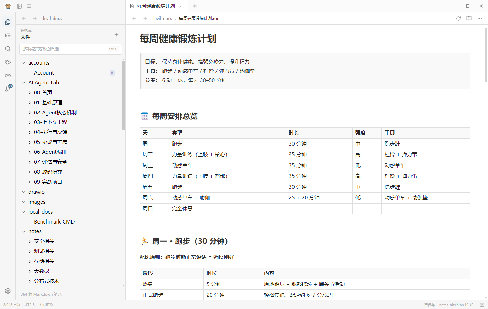

# SpaceNotes

SpaceNotes 是一款面向 Windows 的本地优先 Markdown 笔记应用。它可以直接打开普通
Markdown 文件夹，也可以使用已有的 Obsidian 笔记库，并将编辑、搜索、大纲、反链和
Git 工作流集中在一个桌面界面中。

当前 `feat/macos-adaptation` 分支用于验证 macOS 适配流程。



## 下载与安装

普通用户可从 [Releases](https://github.com/levil3/SpaceNotes/releases) 下载
`Levil Notes Setup x.y.z.exe`，按照 [安装文档](docs/INSTALL.md) 完成安装。

首次启动后，可以直接选择自己的笔记文件夹。笔记库只是普通目录，不会被锁定或导入；
现有的 Obsidian 仓库、Markdown 文件和 Git 历史都可以继续使用。

## 主要功能

- 实时 Markdown 编辑，默认阅读模式，可随时切换为编辑模式。
- 文件树、标题/正文搜索、智能/精确匹配、标签、反链和可折叠大纲。
- 多标签编辑、自动保存、阅读宽度和编辑器外观配置。
- 兼容笔记库相对路径、笔记相对路径和旧笔记中的附件文件名。
- 本地图片、表格和代码块渲染，支持明暗外观与常用主题切换。
- IntelliJ IDEA 风格的 Git 状态颜色、差异查看、暂存、提交、拉取和推送。
- 支持 `.gitignore`、隐藏目录显示开关和单目录/文件忽略操作。
- Git 使用系统安装的 Git，现有凭据管理器、SSH、代理和 Hook 配置继续生效。

## 系统要求

- Windows 10/11 x64。
- 使用 Git 功能时需要安装 [Git for Windows](https://git-scm.com/download/win)。
- 从源码运行或构建时需要 Node.js 18 或更高版本。

## 从源码运行

```powershell
git clone https://github.com/levil3/SpaceNotes.git
cd SpaceNotes
npm ci
npm run dev
```

国内网络下载 Electron 较慢时，可以先切换镜像：

```powershell
$env:ELECTRON_MIRROR="https://npmmirror.com/mirrors/electron/"
npm ci
```

## 验证与构建

```powershell
npm test
npm run build:web
npm run build
```

- `npm run build:web`：执行 TypeScript 检查并构建前端资源。
- `npm run build`：构建 Windows x64 NSIS 安装包。
- 安装包输出目录：`release/`
- 免安装调试版本：`release/win-unpacked/Levil Notes.exe`

仓库包含 Windows 自动构建流程。手动运行 `Build Windows` 工作流可下载构建产物；
推送 `v0.1.0` 这类标签时，会自动创建 GitHub Release 并上传安装包。

## 数据与权限

- 笔记始终保存在你选择的本地文件夹中。
- 应用不会自动提交、自动推送、强制拉取或静默合并。
- Renderer 不拥有 Node.js 或任意文件系统权限，文件与 Git 操作都经过 Electron
  主进程的受限接口。
- Git 变更默认不勾选；已有暂存内容未勾选时会阻止提交，避免误提交。
- 设置保存在 Electron `userData`，不会写入笔记库。

## 项目结构

```text
electron/main.cjs       Electron 生命周期、窗口、协议和 IPC
electron/preload.cjs    受限 IPC API
electron/vault.cjs      笔记库索引、搜索、附件和设置
electron/git.cjs        系统 Git CLI 封装
src/App.tsx             应用状态、标签和工作区编排
src/components/         UI 组件与左侧面板
src/lib/markdown.ts     编辑器图片 URL 与原始 Markdown 往返
```

## 当前边界

- 插件系统、图谱、Canvas、移动端和多设备实时协作尚未实现。
- 不支持自动合并、强制推送、自动提交和云端账号体系。
- 冲突状态会显示，但目前仍需通过常规 Git 工作流处理冲突。

更完整的环境准备、安装、卸载和故障排查说明见 [docs/INSTALL.md](docs/INSTALL.md)。
